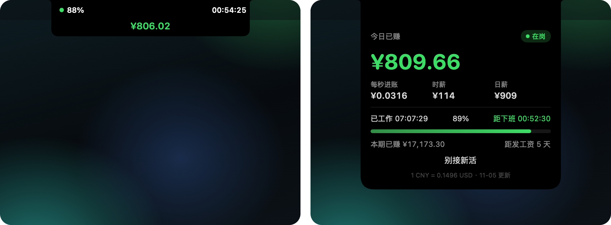
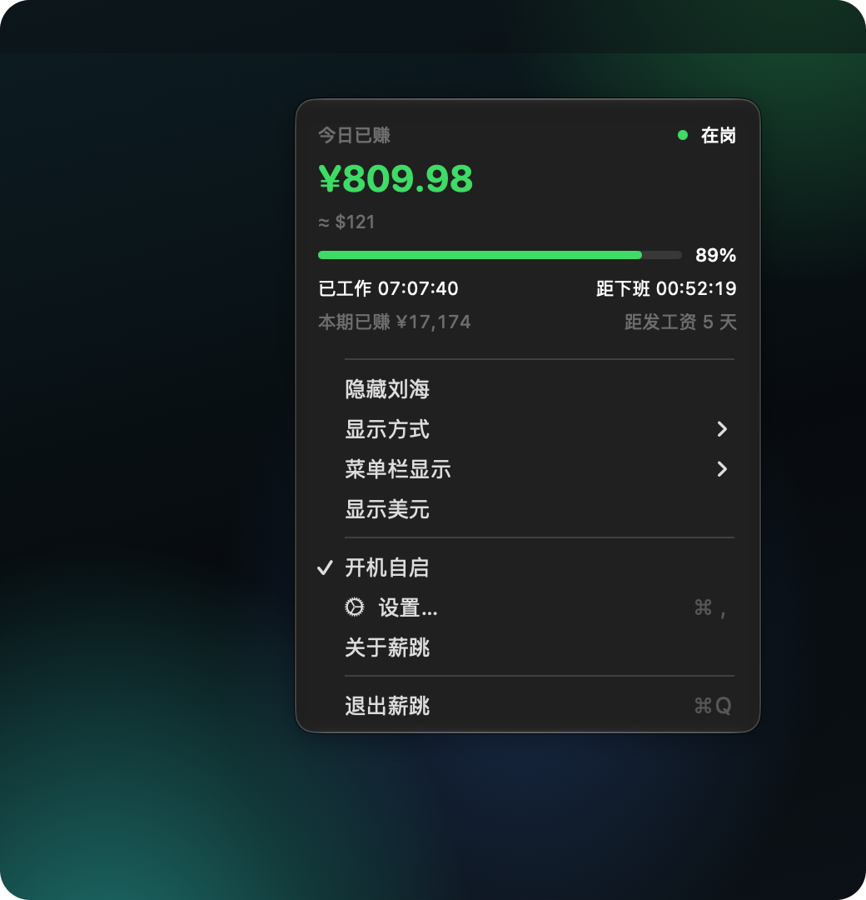
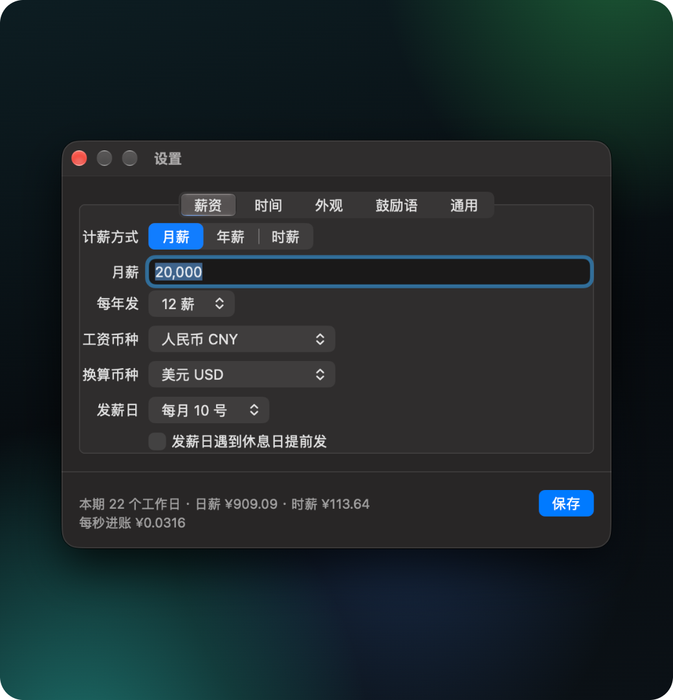

# 薪跳 PayBeat

打工人哄自己上班神器（当然也可能被狗资本家气笑）。

macOS 刘海 / 桌面卡片 + 菜单栏 + 小组件，按秒显示今天已经赚了多少钱。

Coaxes you into going to work (and may make you laugh at your capitalist overlords): a notch island or floating card, a menu bar item and desktop widgets showing what you have earned today, second by second. The interface follows the system language (Chinese or English).

<p align="center"></p>
<p align="center"><a href="docs/paybeat.mp4">高清视频（MP4）</a></p>

## 截图



| 桌面卡片 | 菜单栏 | 设置 |
| :-: | :-: | :-: |
|  |  |  |

## 功能

- 今日已赚按秒跳动，另有每秒进账、每分钟进账、时薪、日薪、工作进度、距下班、本期已赚、距发工资
- 两种显示方式：贴着刘海的黑色岛（鼠标移上去展开成完整卡片，没有刘海时显示在屏幕顶部中间），或可拖动的桌面卡片
- 菜单栏右键：今日概览、切换显示方式和菜单栏内容、换算币种、开机自启
- 月薪、年薪（可设每年几薪）、时薪三种计薪方式
- 21 种工资币种，可再选一个换算币种一键切换，汇率来自 open.er-api.com
- 工作日自选（单休、双休都行），午休可关
- 法定节假日：中国大陆含调休（数据来自 holiday-cn），其他 200 多个国家和地区来自 Nager.Date
- 发薪日碰上休息日可提前发
- 下班后继续计时算加班，可设倍率，卡片上点"下班"结束
- 外观：主题色、深色 / 浅色、不透明度、卡片大小、小数位、卡片显示哪几行，在设置里改动时卡片实时预览
- 菜单栏可显示今日已赚、距下班倒计时，或只显示图标
- 每个阶段的鼓励语可自定义
- 桌面小组件："今日已赚"（小号、中号）和"汇率"（小号）。右键小组件选"编辑"，可以换金额币种、换算币种、小数位，汇率小组件可以任选两种货币
- 开机自启、自动检查更新

## 安装

### 下载

到 [Releases](https://github.com/Tsukinai/paybeat/releases) 下载 `PayBeat-x.y.z.dmg`，打开后把 PayBeat 拖进"应用程序"。需要 macOS 15+，支持 Apple 芯片和 Intel。

app 没有经过 Apple 公证，第一次打开会被系统拦下。到"系统设置 > 隐私与安全性"，在页面下方点"仍要打开"。也可以在终端执行：

```sh
xattr -dr com.apple.quarantine /Applications/PayBeat.app
```

第一次打开会先弹出设置，填好工资和上下班时间就开始计时。开机自启在"设置 > 通用"里打开。

### 从源码安装

需要 macOS 15+、Xcode（免费）和 xcodegen（`brew install xcodegen`）。工程由 `project.yml` 生成，`PayBeat.xcodeproj` 不进仓库。

```sh
./install.sh
```

编译 app 和小组件并安装到 `/Applications/PayBeat.app`。改代码后重新运行即可更新。

`./release.sh` 会编译通用版本并打包成 `.build/PayBeat-<版本号>.dmg`，版本号在 `Info.plist` 里改。

## 使用

- 点大金额，或右键卡片 / 菜单栏：在工资币种和换算币种之间切换
- 卡片右上角"–"：隐藏卡片；左键点菜单栏：显示或隐藏卡片
- 右键卡片或菜单栏，选"设置…"
- 拖动卡片任意位置移动，位置会记住

## 怎么算的

- 本期：上个发薪日的次日到这个发薪日。发薪日超过当月天数时（如 2 月 30 号）按当月最后一天算
- 月薪、年薪：本期收入 = 月薪 × 每年几薪 ÷ 12（年薪则 ÷ 12），平摊到本期每个工作日的工作时间里。发薪日下班时，本期已赚正好等于本期收入
- 时薪：每秒进账 = 时薪 ÷ 3600
- 卡片上的时薪、日薪默认按实际工作时间算，也可以改成按固定天数和小时（比如每月 21.75 天、每天 8 小时）
- 节假日不算工作日；中国大陆的调休上班日算工作日

## 小组件

在桌面右键选"编辑小组件…"，搜"薪跳"，把"今日已赚"或"汇率"拖到桌面。金额每分钟更新一次，距下班倒计时每秒走。小组件不联网，读的是 app 存下来的设置、汇率表和节假日缓存，所以 app 要保持运行才会更新汇率。

## 文件

配置和缓存都在 `~/.config/work-ticker/`：`config.json` 是设置，`rate.json` 是汇率表，`holidays/` 是节假日缓存。直接改 `config.json` 的话要重启程序才生效。
